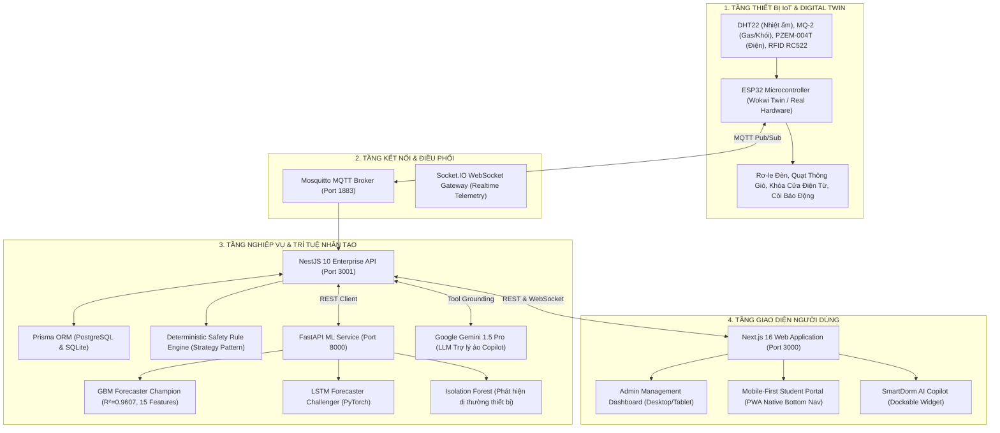

# 🏢 SMARTDORM — Nền Tảng Ký Túc Xá Thông Minh & AI Copilot (Enterprise IoT)

[](https://nextjs.org/)
[](https://nestjs.com/)
[](https://fastapi.tiangolo.com/)
[](https://python.org/)
[](https://www.typescriptlang.org/)
[](https://www.postgresql.org/)
[](https://www.influxdata.com/)
[](https://www.docker.com/)

> **SmartDormitory Monitoring, Management & AI Copilot System**  
> Hệ thống Quản lý Ký Túc Xá Đại học Thông minh cấp thương mại: Tích hợp IoT Digital Twin, Machine Learning Dự báo Phụ tải Đa biến, Trợ lý ảo AI Copilot kiểm chứng dữ liệu thực tế (Data Grounding) và Biểu giá điện bậc thang EVN 6 bậc.

---

## 🏛️ Kiến Trúc Hệ Thống (Architecture Overview)



---

## 🌟 Tính Năng Cốt Lõi (Core Pillars)

### 1. ⚡ Dự Báo Năng Lượng Đa Biến — Mô Hình GBM Champion
- **Thuật toán**: Huấn luyện Gradient Boosting Machine (GBM) với **15 đặc trưng đa biến** (Lags phụ tải 1h-24h, nhiệt độ, độ ẩm môi trường, chỉ số ngày trong tuần, giờ cao điểm).
- **Hiệu năng kiểm toán thực nghiệm**:
  - **Hệ số xác định $R^2$ = 0.9607** (giải thích 96.07% biến thiên phụ tải).
  - **Sai số tương đối MAPE = 4.69%** (chuẩn dự báo lưới điện thông minh).
  - **Độ trễ suy luận (Latency)**: $\approx 8\text{ ms}$, phục vụ realtime inference.
- **Kiến trúc đối soát Model Champion/Challenger**: Tự động so sánh GBM Champion và LSTM Challenger trực quan trên giao diện Recharts.

### 2. 💡 Hóa Đơn Điện Sinh Hoạt Bậc Thang EVN 6 Bậc & Bộ Mô Phỏng
- **Thuật toán tính giá điện lũy tiến**: Áp dụng chuẩn **Biểu giá điện sinh hoạt 6 bậc thang của Tập đoàn Điện lực Việt Nam (EVN)**:
  - *Bậc 1 (0–50 kWh)*: 1.893 đ/kWh
  - *Bậc 2 (51–100 kWh)*: 1.956 đ/kWh
  - *Bậc 3 (101–200 kWh)*: 2.271 đ/kWh
  - *Bậc 4 (201–300 kWh)*: 2.860 đ/kWh
  - *Bậc 5 (301–400 kWh)*: 3.197 đ/kWh
  - *Bậc 6 (> 400 kWh)*: 3.302 đ/kWh
  - Thuế GTGT (VAT 8%) theo quy định nhà nước.
- **Cơ chế chia đều theo đầu người**: Tự động liên kết sĩ số sinh viên thực tế trong phòng để chia tiền điện minh bạch.
- **Interactive Cost Simulator**: Thanh trượt mô phỏng phụ tải (40–350 kWh) giúp sinh viên dự toán chi phí khi sử dụng thiết bị công suất lớn.
- **Xuất Báo Cáo Kế Toán**: Xuất file Excel (.xlsx) đa bảng và bản in PDF chuẩn thanh toán qua mã QR.

### 3. 🤖 Trợ Lý Ảo SmartDorm AI Copilot (Data Grounding)
- **Tích hợp Google Gemini**: Kết nối trực tiếp 12 công cụ truy xuất dữ liệu độc quyền (`CopilotToolsService`).
- **Data Grounding**: Câu trả lời của AI 100% dựa trên dữ liệu cảm biến Wokwi, hóa đơn EVN và nhật ký thẻ RFID thực tế (loại bỏ hoàn toàn hiện tượng AI bịa đặt - Hallucination).
- **Phân quyền RBAC nghiêm ngặt**: Sinh viên chỉ truy vấn dữ liệu phòng của chính mình; Ban quản lý có quyền kiểm soát và tổng hợp dữ liệu toàn trường.
- **Nguyên tắc An Toàn Sinh Mạng**: LLM chỉ có quyền Đọc (Read-Only), tuyệt đối không cấp quyền điều khiển phần cứng trực tiếp cho mô hình sinh ngôn ngữ.

### 4. 📱 Giao Diện Mobile-First & Fault-Tolerant UI
- **Cổng Sinh Viên (`/student/*`)**: Trang bị **Sticky Bottom Navigation Bar** chuẩn ứng dụng di động native với 5 tab: *Trang Chủ, Phòng Ở, Thiết Bị, Điện Năng, Cảnh Báo*.
- **Dockable AI Widget**: Nút bấm AI Copilot tự động nhấc lên trên thanh điều hướng (`bottom-20`), có nút thu gọn (`–`) bám sát mép màn hình chống che khuất nút thao tác.
- **Global Error Boundary (`error.tsx`) & 404 (`not-found.tsx`)**: Ngăn chặn hoàn toàn hiện tượng màn hình trắng xóa (White Screen of Death), tự động phục hồi phiên làm việc khi backend mất kết nối.
- **Toast System**: Bắn thông báo realtime đa cấp độ (*success, warning, critical*).

### 5. 🌡️ An Toàn PCCC & Phản Ứng Khẩn Cấp (Strategy Pattern)
- **Cảm biến DHT22 & MQ-2**: Giám sát nhiệt độ, độ ẩm và nồng độ khí gas liên tục.
- **Cơ chế phản ứng tức thì**: Tự động mở chốt khóa cửa thoát hiểm (DOOR_LOCK), bật quạt thông gió (FAN), ngắt điện thiết bị không thiết yếu và gửi cảnh báo khẩn cấp lên Dashboard/Telegram.

---

## 🛠️ Công Nghệ Sử Dụng (Tech Stack)

| Phân hệ | Công nghệ & Thư viện |
|---|---|
| **Frontend** | Next.js 16 (App Router), TypeScript, TailwindCSS, Lucide Icons, Recharts, Zustand |
| **Backend API** | NestJS 10, TypeScript, Prisma ORM, Socket.IO, MQTT Client, Swagger UI, Nest Throttler |
| **AI / ML Service**| FastAPI, Python 3.11, LightGBM / Scikit-Learn, PyTorch (LSTM), Joblib, Pandas, NumPy |
| **Database** | PostgreSQL 16 (Relational/RBAC), InfluxDB 2.7 (Time-series telemetry), SQLite (Dev) |
| **IoT / Firmware** | C++ ESP32 Firmware, Wokwi Digital Twin Simulator, Mosquitto MQTT Broker |
| **DevOps & Tooling**| Docker, Docker Compose, Jest (Automated Testing), Git |

---

## 📂 Cấu Trúc Thư Mục (Repository Structure)

```
SmartDorm_SourceCode/
├── backend/                   # NestJS 10 API & Business Engine
│   ├── prisma/                # Database schema (Postgres / SQLite) & Seed data
│   └── src/
│       ├── analytics/         # EVN 6-tier progressive tariff calculator & exports
│       ├── devices/           # Device relay control (MQTT Command Client)
│       ├── emergency/         # PCCC Strategy Pattern (Fire & Gas safety)
│       ├── gateway/           # Socket.IO Realtime Telemetry Gateway
│       └── intelligence/      # AI Copilot, ML Client & Benchmark Service
├── frontend/                  # Next.js 16 Frontend Web Application
│   └── src/
│       ├── app/
│       │   ├── dashboard/     # Quản trị viên KTX (Rooms, Devices, Analytics, Models)
│       │   ├── student/       # Cổng sinh viên Mobile-First (Bottom Nav, Energy, Alerts)
│       │   ├── error.tsx      # Global Error Boundary
│       │   └── not-found.tsx  # Custom 404 Page
│       └── components/        # UI components, ToastContext, AiAssistantWidget
├── ml-service/                # FastAPI Machine Learning Microservice
│   ├── anomaly/               # Isolation Forest anomaly detection
│   ├── app/api/               # Forecast & Anomaly endpoints
│   ├── forecasting/           # GBM Champion Forecaster & LSTM Challenger
│   └── models/                # Serialized model artifacts (.joblib, metrics.json)
├── docker-compose.yml         # Containerization setup
├── mosquitto.conf             # MQTT Broker configuration
├── start.ps1                  # 1-Click Launch Script (Windows PowerShell)
└── README.md                  # Project Documentation
```

---

## 🚀 Hướng Dẫn Cài Đặt & Chạy Hệ Thống (Getting Started)

### Cách 1: Khởi động 1 chạm bằng PowerShell (Khuyên dùng)
```powershell
.\start.ps1
```
*Tập lệnh sẽ tự động kiểm tra cổng mạng, khởi động Mosquitto MQTT, FastAPI ML Service, NestJS Backend và Next.js Frontend.*

### Cách 2: Khởi động qua Docker Compose
```bash
docker compose up -d --build
```

### Cách 3: Khởi động từng phân hệ thủ công

#### 1. Backend (NestJS):
```bash
cd backend
npm install
npx prisma generate
npx prisma db push
npm run start:dev
```
- API Endpoint: `http://localhost:3001`
- Swagger Docs: `http://localhost:3001/api/docs`

#### 2. Frontend (Next.js):
```bash
cd frontend
npm install
npm run dev
```
- Web Application: `http://localhost:3000`
- Cổng Sinh Viên: `http://localhost:3000/student/dashboard`
- Cổng Quản Trị: `http://localhost:3000/dashboard`

#### 3. ML Microservice (FastAPI):
```bash
cd ml-service
python -m venv venv
venv\Scripts\activate
pip install -r requirements.txt
python -m uvicorn app.main:app --reload --port 8000
```
- ML API Endpoint: `http://localhost:8000`
- Swagger UI: `http://localhost:8000/docs`

---

## 🧪 Kiểm Thử Tự Động (Automated Testing)

Toàn bộ hệ thống được bảo vệ bởi bộ kiểm thử tự động toàn diện:

```bash
# Kiểm thử toàn diện tầng Intelligence & Automation (18 test cases)
npm --prefix backend test src/intelligence/intelligence.spec.ts

# Kiểm thử tính toán tiền điện EVN & CSDL
npm --prefix backend test

# Kiểm thử cú pháp TypeScript (0 lỗi)
npm --prefix frontend run build
```

---

## 📄 Bản Quyền & Tác Giả (License & Author)

- **Tác giả**: [Nguyễn Tấn Mạnh](https://github.com/tanmanh-31102005)
- **Đồ án**: Hệ Thống Quản Lý Ký Túc Xá Thông Minh & Trợ Lý AI Điều Hành (SmartDorm Enterprise IoT)
- **Giấy phép**: MIT License
