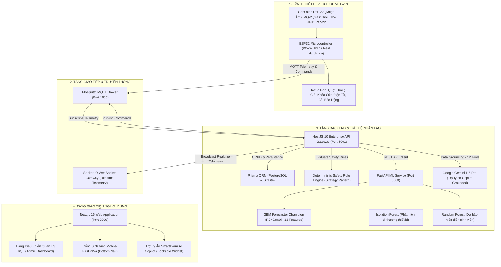

# 🏢 SMARTDORM — Nền Tảng Ký Túc Xá Thông Minh & AI Copilot (Enterprise IoT)

[](https://nextjs.org/)
[](https://nestjs.com/)
[](https://fastapi.tiangolo.com/)
[](https://python.org/)
[](https://www.typescriptlang.org/)
[](https://www.postgresql.org/)
[](https://www.influxdata.com/)
[](https://www.docker.com/)

> **Smart Dormitory Monitoring, Management & AI Copilot System**  
> Nền tảng Quản trị Ký Túc Xá Đại học Thông minh cấp thương mại: Tích hợp IoT Digital Twin, Machine Learning Dự báo Phụ tải Đa biến, Trợ lý ảo AI Copilot kiểm chứng dữ liệu thực tế (Data Grounding) và Biểu giá điện bậc thang EVN 6 bậc.

---

## 🏛️ Kiến Trúc Hệ Thống (Architecture Overview)



---

## 🌟 BẢNG DANH MỤC TÍNH NĂNG TOÀN DIỆN (FULL FEATURE CATALOG)

Hệ thống **SmartDorm Enterprise** được tổ chức thành 4 phân hệ lớn với hơn 25+ tính năng nghiệp vụ chuyên sâu:

### 1. PHÂN HỆ QUẢN TRỊ KÝ TÚC XÁ (ADMIN DASHBOARD — 12 MODULES)

| Module / Trang | Đường dẫn | Chi tiết tính năng & Nghiệp vụ kỹ thuật |
|---|---|---|
| **Tổng Quan (Overview)** | `/dashboard` | Thống kê số lượng phòng, tỷ lệ lấp đầy, số sinh viên lưu trú, tổng điện năng tiêu thụ toàn trường, vi khí hậu các tòa, thẻ tóm tắt sự cố khẩn cấp. |
| **Quản Lý Phòng Ở** | `/dashboard/rooms` | Giám sát danh sách phòng theo tòa và tầng; Chế độ xem thẻ Grid và Bảng Table có `overflow-x-auto`; Hiển thị nhiệt độ, độ ẩm, nồng độ gas và sĩ số từng phòng; Thao tác rơ-le và mở khóa từ xa. |
| **Quản Lý Tòa Nhà** | `/dashboard/buildings` | Thiết lập danh mục tòa nhà (Tòa A, B, C), phân bổ số tầng, cấu hình số phòng và định mức phụ tải. |
| **Quản Lý Cư Dân** | `/dashboard/residents` | Quản lý hồ sơ sinh viên, MSSV, khoa ngành, số điện thoại, quản lý gán mã UID thẻ từ RFID, tra cứu và lọc danh sách. |
| **Giám Sát Thiết Bị IoT** | `/dashboard/devices` | Giám sát trạng thái kết nối Online/Offline, công suất hoạt động (Watts), điều khiển bật/tắt rơ-le đèn, quạt, khóa cửa, còi báo động tức thời qua giao thức MQTT. |
| **Trung Tâm An Ninh** | `/dashboard/security` | Giám sát an ninh vòng ngoài, phát hiện quẹt thẻ bị từ chối (Unauthorized / Denied), cảnh báo hành vi thử thẻ lạ liên tiếp. |
| **Nhật Ký Quẹt Thẻ** | `/dashboard/access-log` | Lưu vết 100% lượt quẹt thẻ: Thời gian, Mã thẻ RFID masked, Tên sinh viên, Số phòng, Hướng đi (ENTRY/EXIT), Kết quả cấp phép (Authorized/Denied). |
| **Bản Đồ Vi Khí Hậu** | `/dashboard/environment` | Giám sát nhiệt độ DHT22, độ ẩm và nồng độ khí gas MQ-2 thời gian thực qua WebSocket; Cảnh báo phân tầng màu (Xanh: Mát, Vàng: Ẩm cao, Đỏ: Nguy hiểm). |
| **Trung Tâm PCCC & Cứu Nạn** | `/dashboard/emergency` | Triển khai **Strategy Pattern** cho 2 kịch bản khẩn cấp: *Hỏa hoạn (Fire)* và *Rò rỉ khí gas (Gas Leak)*; Tự động mở chốt khóa cửa thoát hiểm, bật quạt hút khói và ngắt điện phòng; Nhật ký xử lý sự cố. |
| **Phân Tích Điện Năng** | `/dashboard/energy` & `/analytics` | Biểu đồ phụ tải toàn campus, phân tích giờ cao điểm (Peak Hours), đối chiếu điện năng tiêu thụ giữa các tòa nhà. |
| **Báo Cáo & Xuất Dữ Liệu** | `/dashboard/reports` | Xuất 4 loại báo cáo chuyên sâu (Điện năng, An ninh RFID, Sự cố khẩn cấp, Sức khỏe thiết bị IoT); Xuất bảng tính **Excel (.xlsx)** đa bảng và bản in **PDF** chuẩn kiểm toán kèm chữ ký BQL. |
| **Cài Đặt Hệ Thống** | `/dashboard/settings` | Cấu hình ngưỡng nhiệt an toàn, ngưỡng gas MQ-2 nguy hiểm, tích hợp cảnh báo qua Telegram Bot và Email SMTP. |

---

### 2. PHÂN HỆ TRÍ TUỆ NHÂN TẠO & MLOPS (`/dashboard/intelligence` — 6 MODULES)

| Module / Trang | Thuật toán & Công nghệ | Mô tả tính năng & Chỉ số hiệu năng |
|---|---|---|
| **Dự Báo Phụ Tải Đa Biến** | `Gradient Boosting (GBM)` | Huấn luyện với **13 đặc trưng đa biến** (chu kỳ giờ/ngày, nhiệt ẩm vi khí hậu, trạng thái thiết bị); Đạt **$R^2 = 0.9607$**, **$MAPE = 4.69\%$**, độ trễ suy luận $\approx 8\text{ms}$; Mô hình Champion duy nhất được tinh gọn đưa vào sản xuất. |
| **Phát Hiện Dị Thường Thiết Bị** | `Isolation Forest` | Học máy không giám sát phát hiện thiết bị tiêu thụ điện bất thường, tính toán **Anomaly Score (0.00 – 1.00)**; Nhận diện sớm nguy cơ chập cháy rơ-le hoặc rò rỉ điện. |
| **Dự Báo Hiện Diện Sinh Viên** | `Random Forest Classifier` | Dự báo xác suất có mặt sinh viên trong phòng (độ chính xác ~89.2%); Đưa ra danh sách phòng trống đang bật thiết bị để tối ưu hóa năng lượng. |
| **Đề Xuất & Tự Động Hóa** | `Deterministic Rule Engine` | Quản lý vòng đời khuyến nghị tự động hóa (Generated ➔ Pending ➔ Accepted ➔ Executed); Tự động tắt thiết bị khi phòng không có người sau 30 phút. |
| **Quản Trị Vòng Đời MLOps** | `ML Client & Drift Detection` | Giám sát độ trôi dữ liệu (Data Drift) và độ lỗi thời (Model Staleness); Cơ chế 1-click chuyển đổi mô hình chủ đạo (Promote Champion Model). |
| **Trợ Lý Ảo Điều Hành** | `Google Gemini 1.5 Pro` | Trang bị 12 công cụ truy xuất dữ liệu nội bộ (`CopilotToolsService`); Data Grounding loại bỏ hoàn toàn bịa đặt; Tách biệt an toàn sinh mạng (Read-Only). |

---

### 3. PHÂN HỆ CỔNG THÔNG TIN SINH VIÊN (STUDENT PORTAL — 6 MODULES)

| Module / Trang | Đường dẫn | Chi tiết tính năng người dùng sinh viên |
|---|---|---|
| **Bảng Điều Khiển Sinh Viên** | `/student/dashboard` | Cá nhân hóa theo phòng của sinh viên: 4 thẻ KPI phòng (Nhiệt độ, Độ ẩm, Điện tiêu thụ hôm nay, Thiết bị online); Bảng điều khiển 1 chạm (1-Tap Control); Danh sách bạn cùng phòng; Lịch sử quẹt thẻ gần nhất. |
| **Điều Khiển Rơ-le Phòng** | `/student/devices` | Bật/tắt đèn chiếu sáng, quạt thông gió, khóa/mở chốt cửa phòng từ xa qua MQTT; Giám sát tổng công suất tiêu thụ thời gian thực (Watts). |
| **Điện Năng & Biểu Giá EVN** | `/student/energy` | Biểu đồ tiêu thụ điện 7 ngày qua; **Bảng kê chi tiết 6 bậc thang điện sinh hoạt EVN 2026** (Bậc 1 đến Bậc 6, VAT 8%); Tự động chia đều hóa đơn theo số sinh viên trong phòng; **Bộ mô phỏng chi phí tương tác (Slider 40-350 kWh)**; Xuất hóa đơn Excel (.xlsx) và In/Lưu PDF chuẩn thanh toán QR. |
| **Cảnh Báo & Thông Báo** | `/student/alerts` | Tiếp nhận thông báo tiền điện từ BQL; Cảnh báo quá nhiệt/khí gas phòng kèm 3 nút can thiệp khẩn cấp: *Ngắt điện, Bật quạt thông gió, Mở chốt cửa*. |
| **Hồ Sơ Phòng Ở** | `/student/room` | Thông tin hợp đồng lưu trú, ngày nhận phòng, hạn hợp đồng; Danh bạ sinh viên cùng phòng (MSSV, lớp, số điện thoại bấm gọi ngay). |
| **Lịch Sử Quẹt Thẻ Cá Nhân** | `/student/access-history` | Xem lại toàn bộ lịch sử quẹt thẻ ra/vào phòng của chính mình kèm mốc thời gian chi tiết. |

---

### 4. TẦNG BẢO MẬT, GIAO THỨC & NỀN TẢNG CỐT LÕI

| Thành phần nền tảng | Công nghệ triển khai | Mục đích & Lợi ích mang lại |
|---|---|---|
| **Xác thực & Phân quyền** | `JWT + RBAC Guards` | Bảo vệ toàn bộ API; Sinh viên chỉ xem được phòng của mình (`authorizedRoom`); Admin toàn quyền quản trị toàn trường. |
| **Bảo Vệ Chống Tấn Công** | `NestJS ThrottlerModule` | Rate Limiting giới hạn tần suất gọi API, chống brute-force mã thẻ RFID và spam lệnh điều khiển thiết bị MQTT. |
| **Truyền Thông Thời Gian Thực** | `Mosquitto MQTT & Socket.IO` | MQTT xử lý lệnh điều khiển và nhận dữ liệu vi điều khiển ESP32; Socket.IO phát trực tiếp lên Frontend với độ trễ < 50ms. |
| **Giao Diện Phục Hồi Lỗi** | `Global Error Boundary` | Tệp `frontend/src/app/error.tsx` bắt mọi lỗi JavaScript runtime, cung cấp nút "Thử tải lại" và "Về trang chủ", ngăn chặn 100% màn hình trắng. |
| **Trải Nghiệm Di Động Native** | `Mobile Bottom Navigation` | Thanh điều hướng đáy 5 tab bám sát màn hình điện thoại; Nút AI Copilot tự động nhấc vị trí và hỗ trợ thu gọn (`–`) vào mép màn hình (Edge Docking). |
| **Chống Tràn Viền Bảng Dữ Liệu** | `.table-responsive` | Bọc `overflow-x-auto` cho toàn bộ bảng biểu dữ liệu, hỗ trợ vuốt chạm cảm ứng mượt mà trên điện thoại. |

---

## 🛠️ Công Nghệ Sử Dụng (Tech Stack)

| Phân hệ | Công nghệ & Thư viện |
|---|---|
| **Frontend** | Next.js 16 (App Router), TypeScript, TailwindCSS, Lucide Icons, Recharts, Zustand |
| **Backend API** | NestJS 10, TypeScript, Prisma ORM, Socket.IO, MQTT Client, Swagger UI, Nest Throttler |
| **AI / ML Service**| FastAPI, Python 3.11, Scikit-Learn Champion GBM, Isolation Forest, Joblib, Pandas, NumPy |
| **Database** | PostgreSQL 16 (Relational/RBAC), InfluxDB 2.7 (Time-series telemetry), SQLite (Dev) |
| **IoT / Firmware** | C++ ESP32 Firmware, Wokwi Digital Twin Simulator, Mosquitto MQTT Broker |
| **DevOps & Tooling**| Docker, Docker Compose, Jest (Automated Testing), Git |

---

## 🚀 Hướng Dẫn Cài Đặt & Chạy Hệ Thống (Getting Started)

### Cách 1: Khởi động 1 chạm bằng PowerShell (Khuyên dùng)
```powershell
.\start.ps1
```
*Tập lệnh sẽ tự động kiểm tra cổng mạng, khởi động Mosquitto MQTT, FastAPI ML Service, NestJS Backend và Next.js Frontend.*

### Cách 2: Khởi động qua Docker Compose (Hoặc Triển Khai Cloud VPS)
```bash
# Trên máy tính cục bộ hoặc Cloud VPS Ubuntu 22.04 LTS:
cp .env.docker.example .env.docker
docker compose --env-file .env.docker up -d --build
docker exec smartdorm-backend node dist/prisma/seed-demo.js
```
> Chi tiết xem cẩm nang triển khai VPS Cloud: **[HUONG_DAN_THUE_VA_CAI_DAT_VPS_CLOUD.md](HUONG_DAN_THUE_VA_CAI_DAT_VPS_CLOUD.md)** hoặc chạy script tự động 1-click **[deploy_vps.sh](deploy_vps.sh)**.
>
> 📁 **Tài liệu Kỹ thuật & Kịch bản Nghiệm thu Đồ án:**
> * 📚 **[docs/smartdorm_docs/INDEX_TAI_LIEU.md](docs/smartdorm_docs/INDEX_TAI_LIEU.md)**: Bộ tài liệu kỹ thuật đầy đủ 11 phần (Kiến trúc, Phần cứng ESP32, Backend, Database, ML Service, Frontend, API Reference) phục vụ viết báo cáo.
> * 📝 **[docs/Template_KhoaCNTT_fixed.docx](docs/Template_KhoaCNTT_fixed.docx)**: File mẫu báo cáo chuẩn Khoa CNTT.
> * 🎬 **[KICH_BAN_QUAY_CLIP_DEMO_VA_CHUP_ANH_MINH_CHUNG.md](KICH_BAN_QUAY_CLIP_DEMO_VA_CHUP_ANH_MINH_CHUNG.md)**: Kịch bản từng giây quay video demo và bảng checklist 5 góc chụp ảnh phần cứng minh chứng.
> * 🛠️ **[HUONG_DAN_LAP_RAP_PHAN_CUNG_CHI_TIET.md](HUONG_DAN_LAP_RAP_PHAN_CUNG_CHI_TIET.md)**: Cẩm nang đấu nối phần cứng thực tế 0% hàn, Active-LOW cho ESP32 và bo Relay 4 kênh.
> * 🖼️ **[Poster_SmartDorm_KhoaCNTT.pptx](Poster_SmartDorm_KhoaCNTT.pptx)**: Poster bảo vệ đồ án kích thước chuẩn khổ A0 Khoa CNTT.

---

## ☁️ Hệ Thống Cloud VPS Đang Vận Hành (Live Production)

Hệ thống SmartDorm đã được triển khai thực tế và kiểm thử hoàn chỉnh trên Cloud VPS tại **Datacenter FPT - Hồ Chí Minh**:

* **Thông số máy chủ:** Hostname `SmartDorm` • IPv4 `103.74.100.132` • Ubuntu 22.04.5 LTS • 2 vCPU Intel Xeon Gold-6148 • 4 GB RAM (+ 4 GB Swap RAM) • 50 GB SSD NVMe • Firewall UFW đang bật (`22, 80, 443, 3000, 3001, 8000, 1883, 9001`).

### 🔗 Link Truy Cập Dịch Vụ Live

| Dịch vụ / Thành phần | Đường dẫn truy cập (URL / Endpoint) | Ghi chú |
|---|---|---|
| **Web Dashboard (Next.js 16)** | http://103.74.100.132:3000 | Giao diện Quản trị BQL & Cổng Sinh viên |
| **Backend REST API & Swagger** | http://103.74.100.132:3001/api/docs | Tài liệu & kiểm thử API tương tác |
| **AI / ML FastAPI Docs** | http://103.74.100.132:8000/docs | API Dự báo GBM, Isolation Forest, Random Forest |
| **ML Service Health Check** | http://103.74.100.132:8000/ml/health | Kiểm tra trạng thái sống dịch vụ AI/ML |
| **MQTT Broker (ESP32 / IoT)** | `103.74.100.132:1883` *(WS: `9001`)* | Broker Mosquitto 2.0 nhận telemetry từ ESP32 |

### 🔐 Tài Khoản Đăng Nhập Mẫu

| Vai trò | Email | Mật khẩu | Phạm vi truy cập |
|---|---|---|---|
| **Quản trị viên (Admin)** | `admin@ktx.edu.vn` | `admin123` | Toàn bộ 18 phòng, thiết bị, PCCC, AI Copilot, xuất Excel/PDF |
| **Sinh viên (Student)** | `sv001@student.edu.vn` | `sinhvien123` | Phòng 101, điều khiển đèn/quạt/cửa, tiền điện EVN 6 bậc |

### 🔌 Kết Nối Phần Cứng ESP32 Với Cloud VPS
Firmware trong `hardware/src/main.cpp` đã cấu hình sẵn `MQTT_BROKER_PRIMARY = "103.74.100.132"` (fallback `broker.hivemq.com`). Khi cắm mạch ESP32 qua cáp USB Type-C, chạy lệnh sau để nạp vào bo mạch:
```powershell
& "$HOME\.platformio\penv\Scripts\platformio.exe" run -d hardware -t upload
```

---

## 🛠️ Quy Trình Vận Hành, Sửa Lỗi & Re-Deploy Trên Cloud VPS

Tất cả mã nguồn vận hành trên máy chủ đặt tại `/app/smartdorm`. Quy trình chi tiết xem thêm ở Mục 8 trong **[HUONG_DAN_THUE_VA_CAI_DAT_VPS_CLOUD.md](HUONG_DAN_THUE_VA_CAI_DAT_VPS_CLOUD.md)**.

### 1. Truy cập SSH & Kiểm tra sức khỏe 6 Container
```bash
ssh root@103.74.100.132
cd /app/smartdorm

# Kiểm tra trạng thái tất cả container (phải thấy Up / healthy)
docker compose --env-file .env.docker ps

# Kiểm tra RAM, Swap và tải CPU
free -h && docker stats --no-stream

# Xem log realtime khi có sự cố (Ctrl+C để thoát)
docker logs -f --tail 100 smartdorm-backend
docker logs -f --tail 100 smartdorm-frontend
docker logs -f --tail 100 smartdorm-ml-service
docker logs -f --tail 100 smartdorm-mqtt
```

### 2. Quy trình 5 bước Sửa Lỗi & Đưa Bản Vá Lên Cloud
1. **Khoanh vùng lỗi:** Dùng `F12` (Console/Network) trên trình duyệt kết hợp `docker logs` ở bước trên để xác định lỗi nằm ở `frontend`, `backend`, `ml-service` hay `mqtt`.
2. **Sửa & test biên dịch tại Local trước** (không sửa code trực tiếp bên trong container):
   * Backend: `cd backend && npm run build`
   * Frontend: `cd frontend && npx tsc --noEmit`
3. **Đẩy file đã sửa lên VPS:**
   ```powershell
   # Đẩy nhanh 1 file vừa sửa từ Windows lên VPS:
   scp backend\src\devices\devices.service.ts root@103.74.100.132:/app/smartdorm/backend/src/devices/
   ```
   *(Hoặc `git push` từ local rồi trên VPS vào `/app/smartdorm` chạy `git pull` nếu đã cấu hình remote).*
4. **Rebuild đúng Container bị sửa (giữ nguyên Database):**
   ```bash
   cd /app/smartdorm

   # Nếu sửa Backend:
   docker compose --env-file .env.docker up -d --build backend

   # Nếu sửa Frontend (BẮT BUỘC truyền --build-arg IP VPS để Next.js nhúng đúng URL):
   docker compose --env-file .env.docker build --build-arg NEXT_PUBLIC_API_URL=http://103.74.100.132:3001/api --build-arg NEXT_PUBLIC_WS_URL=http://103.74.100.132:3001 frontend
   docker compose --env-file .env.docker up -d frontend

   # Nếu sửa ML Service:
   docker compose --env-file .env.docker up -d --build ml-service

   # Nếu chỉ sửa biến môi trường (.env.docker: Telegram, Gmail, Gemini):
   docker compose --env-file .env.docker up -d --force-recreate backend
   ```
5. **Kiểm tra & Backup dữ liệu an toàn:**
   ```bash
   # Backup SQLite database trước khi sửa lớn hoặc trước buổi bảo vệ:
   cp /app/smartdorm/backend/prisma/dev.db /root/dev.db.backup_$(date +%F_%H%M)

   # Rollback khẩn cấp nếu cần khôi phục database:
   cp /root/dev.db.backup_<ngay_gio> /app/smartdorm/backend/prisma/dev.db
   docker compose --env-file .env.docker restart backend

   # Dọn image build cũ tránh đầy 50 GB SSD:
   docker image prune -f
   ```

> ⚠️ **Lưu ý xung đột Telegram Bot (`409 Conflict`):** Không chạy đồng thời `backend` ở máy cá nhân và `backend` trên VPS với cùng một `TELEGRAM_BOT_TOKEN`, vì Telegram chỉ cho phép 1 tiến trình polling (`getUpdates`) tại một thời điểm.

### Cách 3: Khởi động từng phân hệ thủ công

#### 1. Backend (NestJS):
```bash
cd backend
npm install
npx prisma generate
npx prisma db push
npm run start:dev
```
- API Endpoint: `http://localhost:3001`
- Swagger Docs: `http://localhost:3001/api/docs`

#### 2. Frontend (Next.js):
```bash
cd frontend
npm install
npm run dev
```
- Web Application: `http://localhost:3000`
- Cổng Sinh Viên: `http://localhost:3000/student/dashboard`
- Cổng Quản Trị: `http://localhost:3000/dashboard`

#### 3. ML Microservice (FastAPI):
```bash
cd ml-service
python -m venv venv
venv\Scripts\activate
pip install -r requirements.txt
python -m uvicorn app.main:app --reload --port 8000
```
- ML API Endpoint: `http://localhost:8000`
- Swagger UI: `http://localhost:8000/docs`

---

## 🧪 Kiểm Thử Tự Động (Automated Testing)

```bash
# Kiểm thử toàn diện tầng Intelligence & Automation (18 test cases PASS)
npm --prefix backend test src/intelligence/intelligence.spec.ts

# Kiểm thử tính toán tiền điện EVN & CSDL
npm --prefix backend test

# Kiểm thử biên dịch TypeScript (0 lỗi)
npm --prefix frontend run build
```

---

## 📄 Bản Quyền & Tác Giả (License & Author)

- **Tác giả**: [Nguyễn Tấn Mạnh](https://github.com/tanmanh-31102005)
- **Đồ án**: Hệ Thống Quản Lý Ký Túc Xá Thông Minh & Trợ Lý AI Điều Hành (SmartDorm Enterprise IoT)
- **Giấy phép**: MIT License
