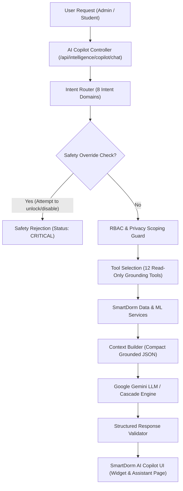

# SmartDorm AI Copilot — LLM Architecture & Grounding Documentation

> **Phiên bản**: 2.0.0-AI-UPGRADE  
> **Cập nhật**: Tháng 8/2026  
> **Trạng thái**: Production Ready — Data Grounded & RBAC Guarded

---

## 1. Tổng Quan Hệ Thống (Executive Summary)

**SmartDorm AI Copilot** là hệ thống trợ lý ảo thông minh đa tầng, được thiết kế chuyên biệt cho công tác quản trị và tối ưu hóa vận hành ký túc xá thông minh quy mô 248 phòng sinh viên. 

Khác với các chatbot LLM tổng quát (generic chatbots) thường dễ bị ảo giác (hallucination) hoặc không có sự kết nối với dữ liệu vận hành thực tế, **SmartDorm AI Copilot** hoạt động theo nguyên lý **Data Grounding** tuyệt đối:
- **Căn cứ dữ liệu thời gian thực**: Trích xuất dữ liệu từ Wokwi ESP32 Digital Twin, cơ sở dữ liệu PostgreSQL qua Prisma, luồng telemetry MQTT và hệ thống học máy AI/ML (Champion Gradient Boosting GBM, Isolation Forest, Random Forest).
- **Phân quyền người dùng nghiêm ngặt (RBAC Grounding)**: Sinh viên chỉ được tra cứu thông tin phòng của chính mình; Ban quản lý (Admin) có quyền phân tích toàn diện toàn campus.
- **Tách biệt an toàn phần cứng (Zero Physical Control)**: LLM là tầng đọc dữ liệu và hỗ trợ ra quyết định (Read-Only / Decision Support), tuyệt đối không nắm quyền phát lệnh MQTT điều khiển rơ-le hoặc can thiệp quy tắc an toàn PCCC khẩn cấp.

---

## 2. Sơ Đồ Kiến Trúc Đa Tầng (End-to-End Pipeline)



---

## 3. Danh Mục 12 Công Cụ Grounding Dữ Liệu (Read-Only Tools)

Tất cả các công cụ đều được quản trị trong [CopilotToolsService](file:///d:/DACNTT2/SmartDorm_SourceCode/backend/src/intelligence/copilot/tools/copilot-tools.service.ts):

| STT | Tên Tool | Miêu tả chức năng | Nguồn dữ liệu (Data Source) | Phân quyền (RBAC) |
| :--- | :--- | :--- | :--- | :--- |
| 1 | `get_current_energy` | Tra cứu phụ tải tức thời và tổng kWh tiêu thụ toàn campus | `DEVICE_STATE_POWER_ESTIMATE`, `POSTGRES/SQLITE` | Admin |
| 2 | `get_room_energy` | Tra cứu chi tiết công suất & thiết bị bật/tắt từng phòng | `DEVICE_STATE_POWER_ESTIMATE`, `PRISMA` | Scoped (Student: Chỉ phòng mình) |
| 3 | `get_energy_forecast` | Dự báo phụ tải 24h & 7 ngày kèm khoảng tin cậy ±10% | `GBM_CHAMPION_FORECASTER`, `ML_SERVICE` | Admin / Student |
| 4 | `get_energy_anomalies` | Danh sách thiết bị dị thường, điểm bất thường Isolation Forest | `ISOLATION_FOREST`, `PRISMA` | Admin |
| 5 | `get_room_environment` | Vi khí hậu phòng (Nhiệt độ DHT22, Độ ẩm, Khí gas MQ-2) | `WOKWI_DHT22_MQ2_STREAM` | Scoped (Student: Chỉ phòng mình) |
| 6 | `get_sensor_status` | Trạng thái trực tuyến của cảm biến vi khí hậu & MQTT | `MQTT_HEARTBEAT`, `WOKWI_TWIN` | Admin |
| 7 | `get_access_logs` | Nhật ký quẹt thẻ RFID ra vào KTX | `PRISMA_ACCESS_LOGS`, `RFID_RC522` | Scoped (Student: Chỉ lịch sử mình) |
| 8 | `get_security_events` | Cảnh báo quẹt thẻ trái phép hoặc sự cố mở cửa cưỡng bức | `RFID_RC522_EVENTS` | Admin |
| 9 | `get_occupancy_prediction`| Dự báo tỷ lệ có mặt sinh viên và danh sách phòng trống | `RANDOM_FOREST_CLASSIFIER` | Admin |
| 10 | `get_active_models` | Chỉ số độ chính xác (MAE 8.28 kW, R² 0.961) của Champion GBM | `ML_MODEL_REGISTRY` | Admin |
| 11 | `get_model_health` | Độ trễ suy luận, kích thước tập train và cảnh báo Drift | `FASTAPI_HEALTH_CHECK` | Admin |
| 12 | `get_recommendations` | Danh sách khuyến nghị cắt đỉnh tải và chính sách Pre-cooling | `RECOMMENDATION_ENGINE` | Admin / Student |
| 13 | `get_system_status` | Trạng thái tổng thể toàn bộ hệ sinh thái SmartDorm IoT | `SYSTEM_HEALTH_MONITOR` | Toàn quyền |

---

## 4. Phân Quyền RBAC & Quyền Riêng Tư (Privacy Scoping)

1. **Sinh Viên (`STUDENT`)**:
   - Khi sinh viên hỏi về vi khí hậu, phụ tải điện hoặc lịch sử quẹt thẻ, hệ thống tự động gán phạm vi vào đúng mã phòng của sinh viên (ví dụ: `A101`).
   - Nếu sinh viên yêu cầu tra cứu phòng khác hoặc số liệu toàn trường $\rightarrow$ Hệ thống lập tức trả về `privacyNotice`:
     > `🔒 Cảnh báo Quyền Riêng Tư (RBAC): Bạn đang đăng nhập với quyền Sinh viên nên chỉ có thể tra cứu thông tin phòng của bạn (A101). Số liệu tổng hợp toàn campus và các phân tích quản trị chỉ dành cho Ban Quản Lý.`

2. **Ban Quản Lý (`ADMIN`)**:
   - Có toàn quyền tra cứu số liệu toàn trường, so sánh giữa các tòa nhà A, B, C, xem danh sách phòng trống và can thiệp bảo trì thiết bị sự cố.

---

## 5. Minh Bạch Nguồn Dữ Liệu Mô Phỏng Wokwi & Phần Cứng Thực

Hệ thống kết nối trực tiếp với **ESP32 Phần Cứng Thật** và **Wokwi Digital Twin**:
- Mọi dữ liệu vi khí hậu và năng lượng sinh ra từ Digital Twin đều được gắn nhãn định danh minh bạch:
  ```json
  {
    "dataSourceType": "WOKWI_SIMULATION",
    "dataSources": ["DEVICE_STATE_POWER_ESTIMATE", "WOKWI_DHT22_MQ2_STREAM"]
  }
  ```
- Giao diện Copilot UI tự động hiển thị Badge màu vàng cam `Wokwi ESP32 Simulation` hoặc `Hardware Realtime` để đảm bảo tính minh bạch khoa học, không bao giờ nhầm lẫn dữ liệu ảo với phần cứng thực địa.
